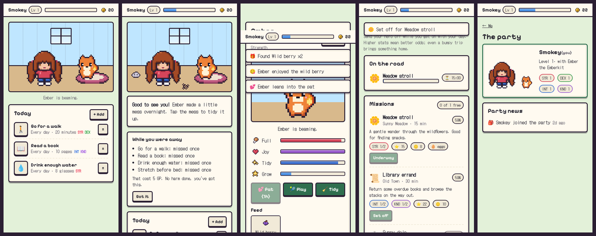

# LevelUp

A habit tracker played as a pixel-art pet RPG. Log the things you do (a walk, a chapter, a
glass of water) and your hero earns XP and coins, trains their stats, levels up, unlocks
abilities and clothes, raises a pet, and goes on missions that bring back eggs, outfits and
new colour themes. Built for Starbase Home at **levelup.starbasehome.net**, behind Authelia.



## What's in it

- **Onboarding**: name your hero, build their look (body, face, features, hair, clothes and
  colours), choose one of three starter partners, pick a few habits.
- **Habits and tasks**: sixteen ready-made habits or build your own: daily, chosen weekdays,
  N times a week or every N days, with a difficulty, the stats it trains, and an optional
  amount (log more, earn more, up to double). One-off tasks too.
- **Stats**: Strength, Dexterity, Intellect and Knowledge train from the activities tagged
  with them. Each level-up also gives two points to place anywhere and one ability point.
- **Abilities**: thirteen passive powers (more XP for a stat, slower pet hunger, streak
  shields, shorter missions, a second mission slot…).
- **Pets**: feed, pat, play and tidy. Needs drift down over time; a happy pet gives +5% XP.
  Pets grow from baby to teen to adult. Eggs from missions hatch from the warmth of your
  activity. Pets never die or run away.
- **Welcome back**: the first visit each day finds a little mess in the pet's room. Tidy it
  for coins, give your partner a pat for XP, and keep a daily return streak with gifts.
  Missed habits break their streak and cost a few GP (capped, never below zero), and the
  home page tells you what happened while you were away.
- **Rest mode**: for illness or travel. No fines, no broken streaks, no hungry pets.
- **Missions**: eight timed trips, gated by level, with success odds from your stats
  (and your partner's help). They pay XP, GP and loot: eggs, clothes, dyes, treats, themes.
- **Shop, wardrobe, themes**: spend GP, dress up, recolour, and switch between six UI
  themes as you unlock them.
- **Party**: everyone on the server, their hero, level, stats and partner, plus a feed of
  level-ups, hatches and mission triumphs. Habit names stay private.

## Develop

```sh
cp .env.example .env        # AUTH_MODE=dev signs every request in as DEV_USER
npm install
npm run dev                 # http://localhost:5173
```

In dev mode, `/dev/skip?hours=24` moves the game clock forward, to see a new day's welcome,
a missed habit, a hungry pet or a finished mission without waiting.

| Command | What it does |
|---|---|
| `npm test` | Unit and module tests (Vitest) |
| `npm run check` | Type checks |
| `npm run lint` | ESLint |
| `npm run build && npm run test:ui` | Browser smoke test with screenshots in `test-results/ui/` |
| `npm run db:generate` | New migration after a schema change |
| `SPRITE_PREVIEW=1 npx vitest run src/lib/sprites/preview` | Contact sheets of all art in `test-results/sprites/` |

[AGENTS.md](./AGENTS.md) has the conventions and how to add content or features.
[docs/ART.md](./docs/ART.md) is the contract for replacing the code-drawn art with PNGs.

## Deploy

Every push to `main` runs CI; when it passes, the deploy job SSHes into the server, pulls,
copies `caddy/levelup.caddy` into Caddy's `sites-enabled`, rebuilds the container and
reloads Caddy (the same steps as the homeserver repo).

One-time setup:

1. **DNS**: point `levelup.starbasehome.net` at the server, unless a wildcard record
   already covers it.
2. **Authelia** (in homeserver-infra): add an access-control rule for
   `levelup.starbasehome.net`, create a `levelup-users` group, and add both of you to it.
3. **On the server**:
   ```sh
   git clone https://github.com/skandaras/profileRPG ~/profileRPG
   cd ~/profileRPG
   docker network inspect shared_net -f '{{range .IPAM.Config}}{{.Subnet}}{{end}}'
   cat > .env <<'ENV'
   TRUSTED_PROXY_IPS=<the subnet printed above>
   ALLOWED_GROUP=levelup-users
   ENV
   ```
4. **GitHub**: add `DEPLOY_HOST` and `DEPLOY_SSH_KEY` as Actions secrets on this repo
   (the same values the homeserver repo uses).
5. Optionally, add a tile to the homepage dashboard (`homepage/server.py` in the
   homeserver repo) for the `levelup-users` group.

The database is a SQLite file in the `levelup_levelup-data` Docker volume. To back it up:

```sh
docker run --rm -v levelup_levelup-data:/data -v "$PWD":/out alpine \
  cp /data/levelup.db /out/levelup-$(date +%F).db
```

### Troubleshooting

| Symptom | Cause |
|---|---|
| `403 Forbidden: request did not arrive via the trusted proxy` | `TRUSTED_PROXY_IPS` does not cover Caddy's address on `shared_net` |
| `401 Unauthorized: no identity headers present` | The `authelia` Caddy snippet is not forwarding `Remote-User` |
| `403 ... not in the levelup-users group` | Add the account to the group in Authelia, or clear `ALLOWED_GROUP` |
| Forms fail with a cross-site error | `ORIGIN` does not match the public URL |
